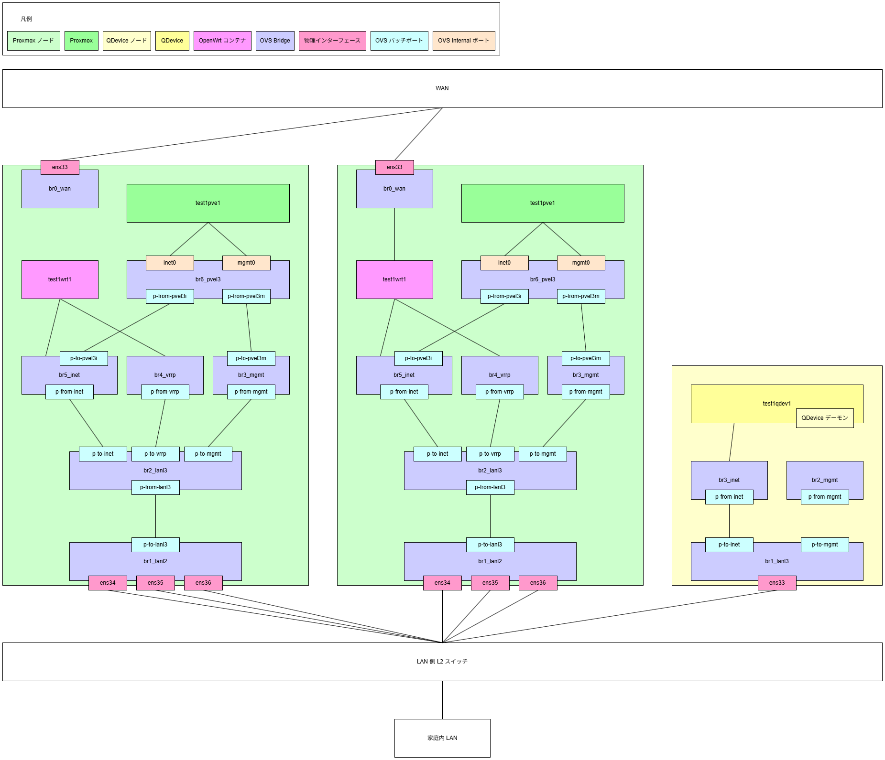

### proxmox-openwrt-redundant-router by Yuichi Yoshii is licensed under the Apache License, Version2.0

### economy 構成
baseline の Elasticsearch & Kibana を VictoriaLogs へ置き換えた構成  
Proxmox / コンテナ側のセットアップスクリプトは perl で記述し、設定値はノードごとの設定ファイル ( TOML ) へ外出ししている  
VictoriaLogs コンテナは CPU 2 コア・メモリ 2 GiB・ディスク 30 GiB ( Elasticsearch の 10 分の 1 ) から運用を開始する

| 項目 | baseline ( Elasticsearch & Kibana ) | economy ( VictoriaLogs ) |
| --- | --- | --- |
| OS | Ubuntu 24.04 | Debian 13 |
| CPU | 6 コア | 2 コア |
| メモリ | 10 GiB | 2 GiB |
| ディスク | 300 GiB | 30 GiB |
| 待ち受けポート | 9200 ( Elasticsearch ) / 5601 ( Kibana ) | 9428 ( HTTP API・Web UI ) / 5140 ( syslog TCP ) |
| SSL | あり | なし |

### 前提
このリポジトリのスクリプトは Proxmox クリーンインストール直後のノードで実行することを前提にしている  
それ以外の状態で実行する場合の動作確認はしていない

### このスクリプトでセットアップする Proxmox と OpenWrt の関係図

### 設定ファイル
各ノードの設定値は、ノードごとの設定ファイル ( TOML ) へ記入する。スクリプト本体を編集する必要はない

| ノード | 設定ファイル | 読み込むスクリプト |
| --- | --- | --- |
| ノード A | node-A/config.toml | node-A/setup.*.pl |
| ノード B | node-B/config.toml | node-B/setup.*.pl |
| QDevice ノード | qdev/config.toml | qdev/setup.pl |

- 設定ファイルはスクリプトごとのテーブル ( [pve], [openwrt], [suricata], [victorialogs] など ) に分かれている
- 複数のスクリプトで使う値 ( ブリッジ名・MAC アドレスなど ) は 1 か所にだけ記入する。どこを参照しているかは設定ファイルのコメントに記載している
- 各スクリプトは同じディレクトリの config.toml を読み込む。別のファイルを使う場合は第 1 引数で指定する ( 例 : ./setup.pve.pl /root/my-config.toml )
- 設定ファイルの読み込みには同梱の lib/SetupConfig.pm を使う ( CPAN モジュールのインストールは不要 ) 。スクリプトと一緒に lib ディレクトリも配置する
- コンテナ・VM の内部で動くスクリプトには、ホスト側スクリプトが必要な設定だけを渡す
    - OpenWrt VM : [openwrt.guest] からシェル変数ファイル /etc/openwrt-setup.conf を生成し、ディスクイメージへ配置する ( OpenWrt には perl が無いため、VM 内のスクリプトは sh のまま )
    - Suricata / VictoriaLogs コンテナ : [suricata.guest] / [victorialogs.guest] だけを切り出した TOML を渡し、セットアップ完了後に削除する

### セットアップ手順

#### ノード A
1. node-A/config.toml へ設定値を記入
    - VRRP 用パスワードを生成して [openwrt.guest] の vrrp_password へ記入する ( ノード B と同じ値 )
1. ノード A へ SSH ログイン
1. ノード A へ node-A ディレクトリを配置 ( lib ディレクトリを含む )
1. setup.pve.pl を実行
    - 自動で再起動する
1. setup.openwrt.pl を実行
1. Suricata が必要な場合
    - setup.suricata.pl を実行
1. VictoriaLogs が必要な場合
    1. OpenWrt で VictoriaLogs コンテナ NIC の固定 IP 設定・DNS レコード登録を済ませる
    1. setup.victorialogs.pl を実行
        - Debian 13 コンテナイメージが無い場合は pveam で自動ダウンロードする
        - 実行後 http://<VictoriaLogs コンテナの IP>:9428/select/vmui で Web UI を確認できる

#### ノード B
1. node-B/config.toml へ設定値を記入
    - [openwrt.guest] の vrrp_password はノード A と同じ値にする
1. ノード B へ SSH ログイン
1. ノード B へ node-B ディレクトリを配置 ( lib ディレクトリを含む )
1. setup.pve.pl を実行
    - 自動で再起動する
1. setup.openwrt.pl を実行
1. Suricata が必要な場合
    - setup.suricata.pl を実行

#### QDevice ノード
1. qdev/config.toml へ設定値を記入
1. QDevice ノードへ SSH ログイン
1. QDevice ノードへ qdev ディレクトリを配置 ( lib ディレクトリを含む )
1. setup.pl を実行
